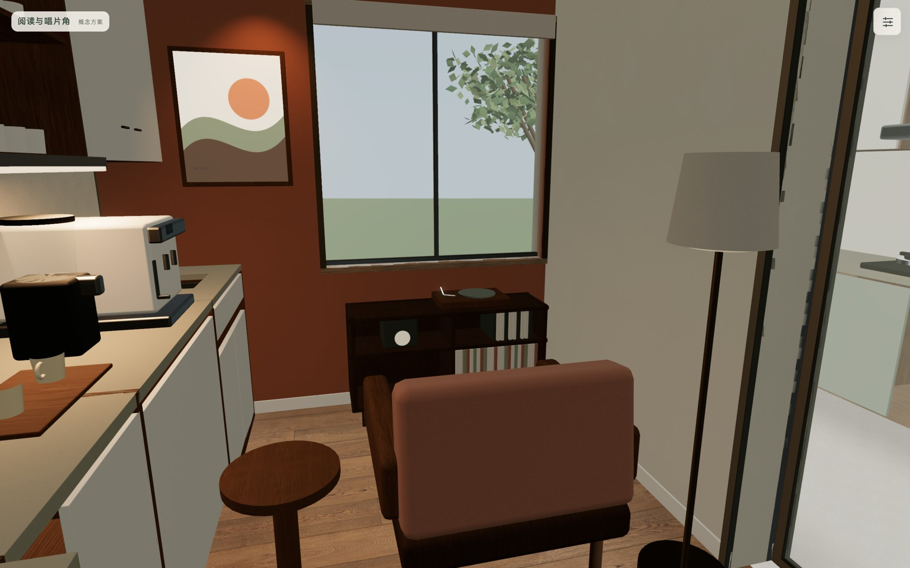
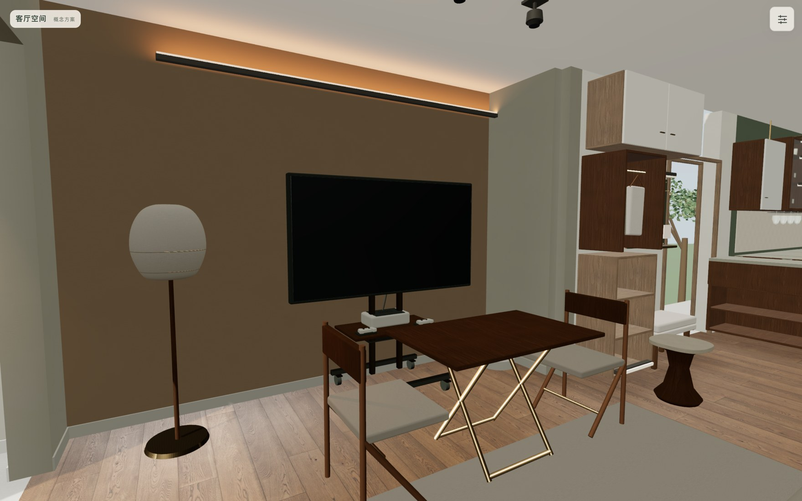
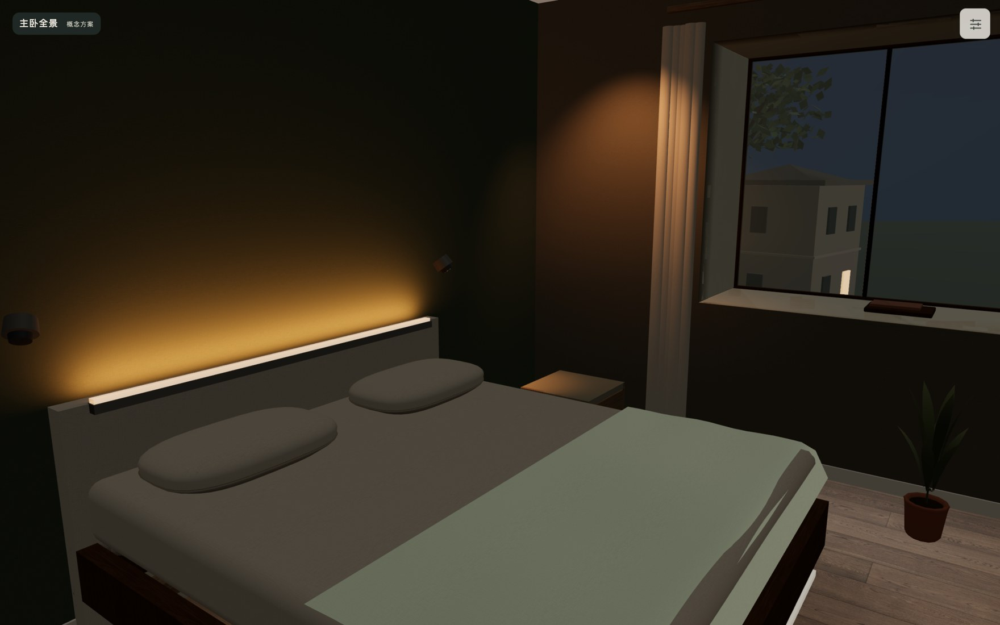

# V10 设计、截图与验证证据

[设计与验证报告 PDF](MuKo%20Home%20V10设计与验证报告.pdf) · [概念平面](V10概念平面.png) · [关键立面与剖面](V10关键立面剖面.png)

[设计符合性](../life-v10.md)与[最高需求基准](../requirements/README.md)独立于客户展示界面。当前模型尚未现场测绘，图纸不能用于施工放线。

## 浏览器实际画面

`screenshots/` 保存桌面与横屏手机尺寸仿真的 22 张实际截图。仿真视口不代表真实手机硬件验证。

## 可复核记录

- [统一模型](home-model.json)：渲染、动作与几何检查的共同数据。
- [视角、抗锯齿及固定分辨率](release-render-audit.json)：22 视图，转向/停止 20 轮，模型缺失和浏览器错误均为零。
- [全屋实际漫步](whole-home-walk-audit.json)：8 房间、42 张截图，页面错误和资源失败为零。原始漫步截图随完整交付压缩包提供。
- [房间反射压力测试](radiance-stress.json)：30 次快速房间/日夜切换和 8 房间顺序切换，未发现纹理销毁或缓存超限。
- [启动加载](startup-load.json)：同一模型，旧启动顺序冷缓存一次 7133ms，最终版 4075ms；缓存重复样本 4087/3986ms。所有 12 张贴图延迟时也可进入漫步，补齐后纹理标识保持不变。测量只清除 HTTP 缓存，未清除 GPU 着色器缓存。
- [本机性能](performance.json)：桌面高画质首次遍历未达到 60fps，横屏手机尺寸仿真约 60fps；两者都不代表真实手机。
- [本机回归](native-validation.json)：完整轮次及故障注入修正复测分别记录；最终精确提交的完整 CI 结果在 GitHub Actions 中查看。

页面可运行、概念模型几何通过、现场适配确认是三个不同结论。现场结构、尺寸、设备型号、五金与真实双人联合使用继续按 BLOCKED / NOT RUN 记录。
