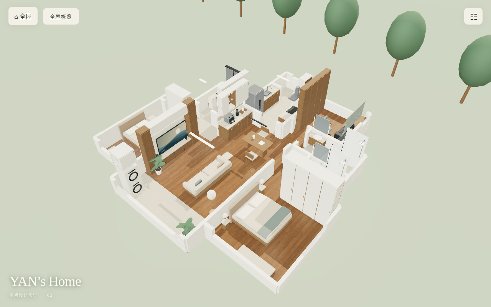

# YAN’s Home · 修订 04

两人住宅的独立三维方案，按用户户型图及本轮确认重新建模。自用电梯厅、玄关改门、南次卧、睡眠主卧、单机位电脑游戏室、咖啡餐厅及并入后的拓展空间均在同一套模型中。

现阶段按用户要求通过 **muko-home 的独立 PR** 提交。源代码位于 `projects/yans-home/`，发布文件位于仓库根目录 `yans-home/`。公开验收入口为：

**https://evilmumuko.github.io/muko-home/yans-home/**

原 muko-home 首页继续保留；未来可将本目录独立迁移到 `yans-home` 仓库。



## 运行

Node.js 24。在本目录执行：

```sh
npm ci
npm run dev
npm run build
npm test
```

构建检查 TypeScript、编译几何变换 WASM、生成 `dist/`。在 muko-home 中构建时另同步 `../../yans-home/`，继续使用现有 main 分支根目录 Pages。CI 核对生成文件可复现并运行浏览器测试。

## 使用与呈现

- 初始在自用电梯厅。左半屏按下的位置出现移动摇杆，右半屏按下的位置出现视角摇杆；双指独立使用，松手、取消触摸或失焦停止。
- 桌面 WASD / 方向键移动，IJKL 转头；鼠标按住拖动转头。家具附近可操作柜门、房门，面板可选空间、照明和导出 PNG。
- 全屋概览可查看合并拓展后的布局；各房间有独立镜头。日间、晚间、静谧三档是概念照明，不是现场日照分析。
- PBR 木纹、织物和墙面按米制 UV 铺设；纹理渐进加载。WebGPU 优先、WebGL2 回退，WASM 失败时使用 JavaScript 几何变换。
- 手机采用稳定像素预算、有限光源、共享环境反射、按需渲染及 30Hz 帧调度上限；桌面增加抗锯齿与环境遮蔽。帧率上限不是实机性能保证。

## 本次修订

[修订04：电脑室与三态沙发床](docs/revision-04.md)：按用户提供的商品图选1250外宽、800收起深度、1920全开总长；保留贯通长桌并错开工位。增加苔绿木框三态沙发床、浅展示层板与650mm通顶双移门柜，检查门柜扫掠和展开后的通行。网页家具面板支持坐姿、躺靠与睡眠切换，碰撞范围随之更新。

[修订 03 计划与实施说明](docs/revision-03.md)：依据用户的小红书实景参考，统一灰咖柜墙、炭灰凹位、浅矿物地面及间接灯光。补充沙发后浅柜、重新布置次卧后的移门衣柜、厨房顶柜、两卫镜柜及上柜、游戏室和电梯厅上柜；保留窗、门和洗衣机前方的留白。新增软包床墙、可开合窗边收纳抽屉，以及手机也可用的静态接触阴影。

[修订 02](docs/revision-02.md) 的玄关凹位、完整游戏室、连续转角窗等要求继续保留。

## 设计与验证

- [确认需求及设计计划](docs/requirements.md)
- [沿用 muko-home 的经验与边界](docs/project-lessons.md)
- [验证范围](docs/validation.md)
- [材质来源](licenses/polyhaven-textures.md)

`src/plan.ts` 是户型、开口、家具和尺寸假设的单一数据源；`src/meshes.ts` 同时生成可见模型、活动部件及碰撞体；`src/main.ts` 负责渲染、空间切换与漫游；`src/controls.ts` 负责浮动双摇杆。

本稿用于空间方案验收。照片的底边尺寸链存在 600mm 差异，初稿明确采用基础 11250mm + 右侧拓展 600mm 的解释，层高暂按 2800mm；均需复尺。原始户型照片不提交至公开仓库。电梯井、楼梯核心及拆改边界未被当作可新增居住空间。
